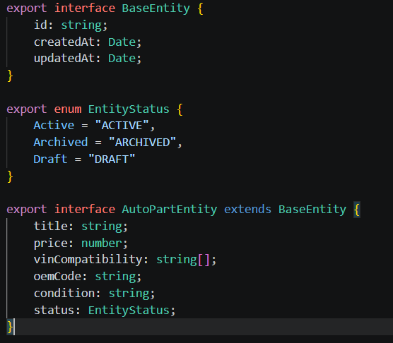
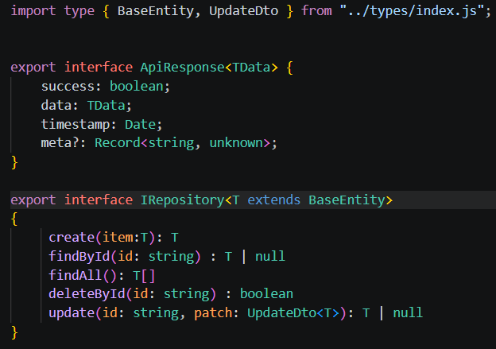
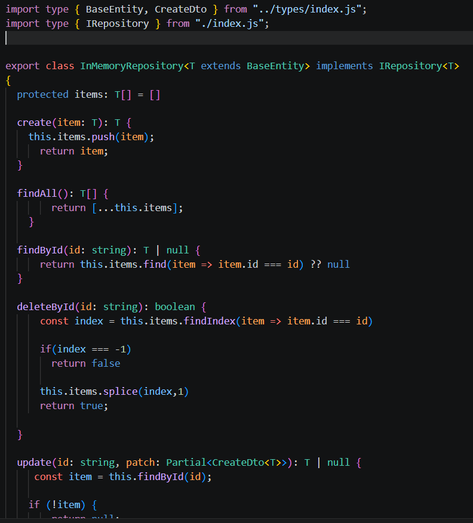
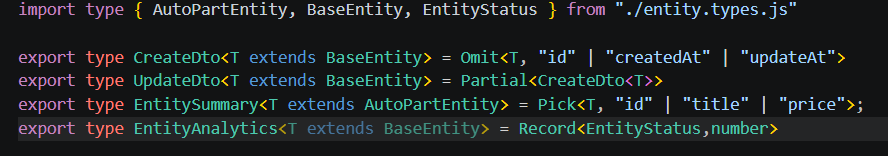
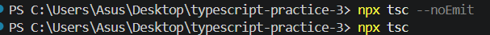
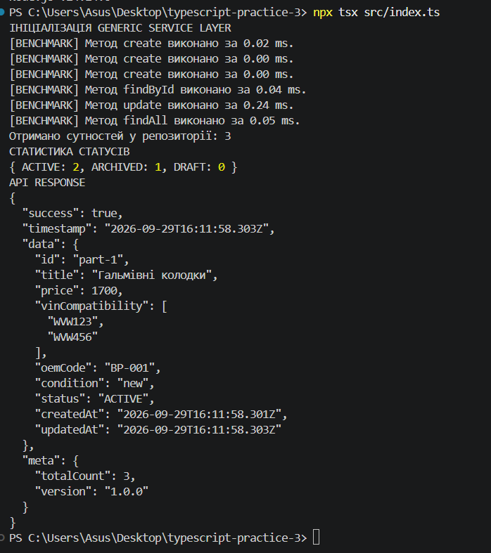

# Практична робота №3

## Узагальнення, декоратори та утиліти типів TypeScript

### Варіант 7 — AutoPartEntity

**Мета роботи:**
Ознайомитися з узагальненнями (Generics), утилітами типів (Utility Types), декораторами та патерном Generic Repository Pattern у TypeScript.

---

## 1. Використані технології

* TypeScript
* Node.js
* tsx
* Generics
* Utility Types
* Decorators
* Generic Repository Pattern
* In-Memory Repository

---

## 2. Структура проєкту

```text
src/
├── types/
│   ├── entity.types.ts
│   ├── utility.types.ts
│   └── index.ts
│
├── repositories/
│   ├── repository.interface.ts
│   ├── in-memory.repository.ts
│   └── index.ts
│
├── decorators/
│   ├── log-execution-time.decorator.ts
│   ├── frozen-entity.decorator.ts
│   └── index.ts
│
└── index.ts
```

---

# Рівень 1 — Generics та Repository Pattern

## 3. Базова сутність

Створено базовий інтерфейс `BaseEntity`, який містить спільні властивості всіх сутностей:

* `id`
* `createdAt`
* `updatedAt`

Також створено `AutoPartEntity` для автомобільних запчастин.

Властивості `AutoPartEntity`:

* `title`
* `price`
* `vinCompatibility`
* `oemCode`
* `condition`
* `status`

### Скріншот



---

## 4. Generic Repository

Створено узагальнений інтерфейс `IRepository<T extends BaseEntity>`.

Він містить основні CRUD-операції:

```text
create()
findById()
findAll()
deleteById()
```

Для обмеження типу використовується:

```ts
T extends BaseEntity
```

Це гарантує, що repository може працювати тільки з сутностями, які мають поля `BaseEntity`.

### Скріншот



---

## 5. InMemoryRepository

Реалізовано generic-клас `InMemoryRepository<T>`.

Дані зберігаються в масиві:

```ts
protected items: T[] = [];
```

Реалізовано:

* створення елемента;
* пошук за `id`;
* отримання всіх елементів;
* видалення за `id`.

### Скріншот



---

# Рівень 2 — Utility Types

## 6. CreateDto

Для створення DTO використано `Omit`.

```ts
type CreateDto<T extends BaseEntity> =
    Omit<T, "id" | "createdAt" | "updatedAt">;
```

Таким чином, поля, які генеруються системою автоматично, виключаються з DTO.

---

## 7. UpdateDto

Для оновлення сутності використано `Partial`:

```ts
type UpdateDto<T extends BaseEntity> =
    Partial<CreateDto<T>>;
```

Це дозволяє передавати тільки ті поля, які потрібно змінити.

Наприклад:

```ts
{
    price: 1500
}
```

Без необхідності передавати всю сутність.

### Скріншот



---

# Рівень 3 — Decorators

# 8. Перевірка компіляції

Для перевірки TypeScript-коду використовується:

```bash
npx tsc --noEmit
```

Команда перевіряє код без створення JavaScript-файлів.

Результат без помилок означає, що TypeScript-код успішно проходить перевірку типів.

### Скріншот



---

# 9. Запуск проєкту

Для запуску TypeScript-файлу без попередньої компіляції використовується:

```bash
npx tsx src/index.ts
```

Для компіляції:

```bash
npx tsc
```

Для запуску скомпільованого JavaScript:

```bash
node dist/index.js
```

### Скріншот



---

# 10. Результат роботи

У ході практичної роботи було реалізовано:

* Generic Repository;
* обмеження generic-типів через `extends`;
* `CreateDto` на основі `Omit`;
* `UpdateDto` на основі `Partial`;
* `EntitySummary` на основі `Pick`;
* `EntityAnalytics` на основі `Record`;
* CRUD-операції;
* часткове оновлення сутностей;
* метод-декоратор `@LogExecutionTime`;
* клас-декоратор `@FrozenEntity`;
* barrel-файли для експорту модулів;
* демонстрацію роботи системи через `src/index.ts`.

---

# 11. Висновок

Під час виконання практичної роботи було отримано практичний досвід використання узагальнень та утиліт типів TypeScript. Було реалізовано універсальний репозиторій, який може працювати з різними сутностями, що наслідують `BaseEntity`.

Також було розглянуто роботу з `Omit`, `Partial`, `Pick` та `Record`, які дозволяють створювати нові типи на основі вже існуючих.

Окремо було реалізовано декоратори для вимірювання часу виконання методів та заморожування класів. У результаті було створено невелику типізовану систему для роботи з автомобільними запчастинами.
